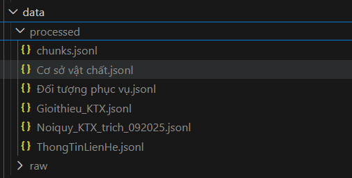
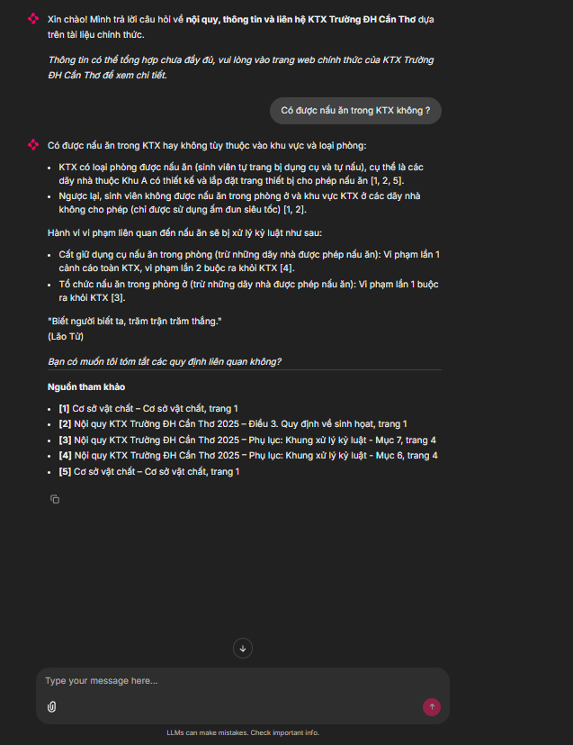

# Dorm RAG – Chatbot hỏi đáp Ký túc xá CTU

Chatbot trả lời câu hỏi về **nội quy, khung xử lý vi phạm, thông tin chung và liên hệ** của Ký túc xá Trường Đại học Cần Thơ, dựa trên tài liệu chính thức và **luôn trích dẫn nguồn**. Khi tài liệu không có thông tin, chatbot từ chối thay vì đoán.



## Mục đích

- Giúp sinh viên tra cứu nhanh nội quy, mức xử lý, tiện ích, người phụ trách.
- Dự án học tập và portfolio



## Điểm kỹ thuật chính

| Vấn đề | Cách giải quyết |
|---|---|
| Văn bản quy chế có cấu trúc | Chunk theo **Điều/Khoản**, gắn tiền tố ngữ cảnh `[Tài liệu > Điều N]` |
| Bảng phạt có ô gộp, tiêu đề 2 tầng, chạy qua nhiều trang | Mỗi hành vi là một chunk, chuẩn hoá thành "Vi phạm lần 1/2/3: ..." |
| Bảng liên hệ | Mỗi người một chunk, giữ ngữ cảnh đơn vị xuyên trang |
| Điểm cosine không phân biệt được câu có/không có đáp án | Lọc bằng **reranker** (cross-encoder) với ngưỡng |
| Chống bịa thông tin | Prompt chỉ dùng context, bắt buộc trích dẫn `[n]`, báo rõ phần thiếu |

## Kiến trúc

```
PDF → parse (pdfplumber) → chunk (4 loại) → embed (bge-m3) → Qdrant
Câu hỏi → vector search (top 20) → rerank (bge-reranker-v2-m3) → lọc theo ngưỡng
        → LLM (Gemini, chuẩn OpenAI-compatible) → câu trả lời + nguồn → UI Chainlit
```

**Công nghệ:** Python, pdfplumber, sentence-transformers (`BAAI/bge-m3`, `BAAI/bge-reranker-v2-m3`), Qdrant, Gemini API qua SDK `openai`, Chainlit.

## Yêu cầu

- Python 3.11+
- Docker (để chạy Qdrant)
- API key Gemini từ [Google AI Studio](https://aistudio.google.com)
- Khoảng 4 GB dung lượng để tải model embedding và reranker (lần chạy đầu)

## Cách chạy

```powershell
# 1. Cài đặt
python -m venv .venv
.venv\Scripts\activate
pip install -r requirements.txt

# 2. Cấu hình: sao chép .env.example thành .env rồi điền key
copy .env.example .env

# 3. Chạy Qdrant
docker run -d -p 6333:6333 -v ${PWD}/qdrant_data:/qdrant/storage qdrant/qdrant

# 4. Đặt PDF vào data/raw/, rồi xử lý dữ liệu
python -m src.ingest.parse          # PDF -> data/processed/*.jsonl
python -m src.ingest.build_chunks   # -> data/processed/chunks.jsonl
python -m src.ingest.index          # nạp vào Qdrant

# 5. Chạy giao diện
chainlit run app/ui.py -w           # mở http://localhost:8000
```

Thử nhanh trên terminal: `python -m src.generation.cli`

## Cấu hình `.env`

```
LLM_API_KEY=your_key_here
LLM_BASE_URL=https://generativelanguage.googleapis.com/v1beta/openai/
LLM_MODEL=<tên model Gemini hiện hành>
```

Tên model Gemini thay đổi thường xuyên, hãy lấy tên đang dùng được từ Google AI Studio hoặc chạy `python -m src.generation.test_llm`. Vì dùng chuẩn OpenAI-compatible nên có thể đổi sang Groq, OpenRouter hoặc Ollama chỉ bằng cách sửa 3 dòng trên.

## Cấu trúc thư mục

```
src/
├── ingest/       # parse, chunk (Điều, bảng phạt, liên hệ, thông tin), index
├── retrieval/    # vector search + rerank + lọc ngưỡng
├── generation/   # prompt, gọi LLM, pipeline ask()
app/ui.py         # giao diện Chainlit
tests/            # test cho các chunker
eval/             # bộ câu hỏi và script đánh giá
```

## Kiểm thử

```powershell
python -m pytest tests -v
```

## Đánh giá

> Đang thực hiện. Bảng dưới sẽ được điền bằng số liệu đo thật từ `eval/run_eval.py`.

| Cấu hình | Hit@5 | MRR | Từ chối đúng | Từ chối nhầm |
|---|---|---|---|---|
| Vector only, chunk cắt cứng | – | – | – | – |
| + Chunk theo cấu trúc | – | – | – | – |
| + Rerank và ngưỡng | – | – | – | – |

Quan sát đã đo: với câu có đáp án, điểm reranker nằm trong khoảng 0.96–0.99; với câu không có đáp án là 0.00–0.02. Điểm cosine của bge-m3 cho hai nhóm này chồng lấn nhau (khoảng 0.55–0.70 so với 0.42–0.55), nên không dùng được làm ngưỡng từ chối. Mẫu thử mới 6 câu, sẽ mở rộng khi có bộ test đầy đủ.

## Hạn chế

- Đang kiểm tra và thu thập hạn chế

## Dữ liệu và quyền riêng tư

Thư mục `data/raw` và `data/processed` không được đưa lên Git vì có thể chứa email, số điện thoại cán bộ. Repo công khai chỉ chứa dữ liệu mẫu (nếu có) trong `data/sample/`.

## Hướng phát triển
